# RapidSwing

A rapid application development framework for Java Swing, targeting **Java 8+**.

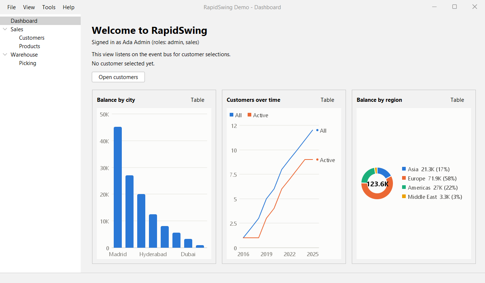

## Modules

| Module | Contents |
|---|---|
| `rapidswing-core` | Application bootstrap, config, services, event bus, background tasks with progress, observable properties, main window, views, navigation tree, quick open, help, dialogs, themes, queries, charts |
| `rapidswing-binding` | Two-way binding between properties and components, converters, validation state, bean adapter |
| `rapidswing-forms` | Fluent form builder (MigLayout) with validation rules, warnings, wizards and user settings |
| `rapidswing-table` | Typed `BeanTableModel` and a `DataGrid` with search, sorting, column chooser, row actions, cell styles, compare, print and CSV export; search panel and paging bar |
| `rapidswing-crud` | Generic list-and-edit screen (`CrudScreen`) with server-side search and paging, detail tables and auto-refresh; `BeanScreens` for any JavaBean |
| `rapidswing-testing` | Test helpers: EDT and interaction helpers, component finders, immediate tasks, scripted dialogs, app harness |
| `rapidswing-logviewer` | Log viewer: several files merged in time order, format detection, regex search, follow mode |
| `rapidswing-rest` | Screens for Spring Boot REST APIs from their OpenAPI document, at runtime or as generated source |
| `rapidswing-generator` | Wizard and command line that generate SDI, MDI, dialog-based and Outlook-style applications |
| `rapidswing-demo` | Sample app showing the framework in use |

## Screenshots

All screenshots show the demo app (`rapidswing-demo`) or apps made by the generator, rendered from the current
code. Each one lists the modules and classes behind it.

### Customers: search, paging, row actions and details

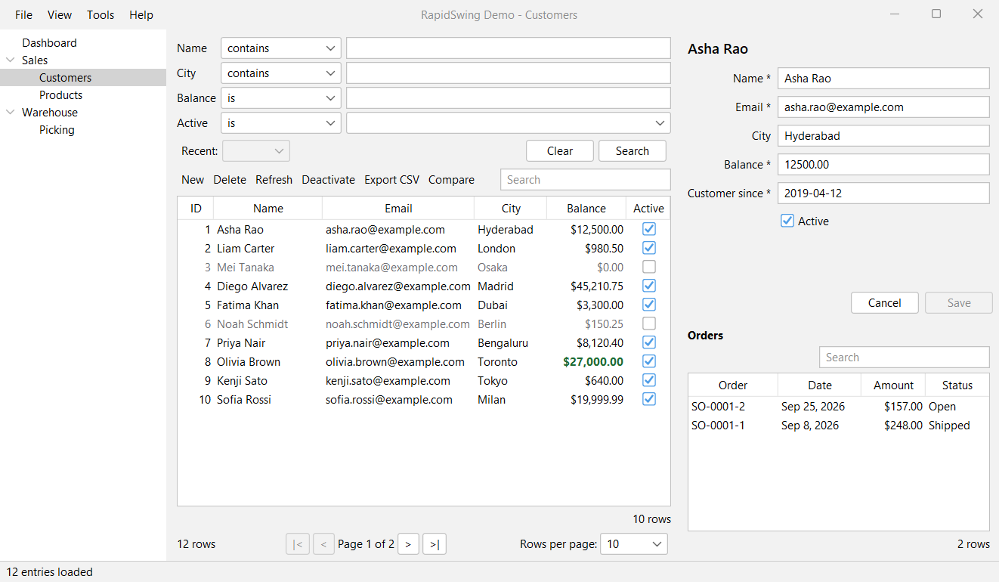

A complete list-and-edit screen, declared in a single builder call
(`rapidswing-demo`: `CustomersScreen`).

| Part of the screen | Module | Classes |
|---|---|---|
| Navigation tree on the left, Ctrl+K quick open | `rapidswing-core` | `NavigationTree`, `MainFrame.setNavigator`, `QuickOpen`, `CommandIndex` |
| The screen as a whole: list, form, New/Delete/Refresh, Save/Cancel | `rapidswing-crud` | `CrudScreen`, `CrudScreen.Builder`, `EditContext` |
| Search fields with operators and recent searches | `rapidswing-table`, `rapidswing-core` | `SearchPanel`; `Query`, `Filter`, `Operator` |
| Paging bar; searching and paging in the repository | `rapidswing-table`, `rapidswing-crud` | `PagingBar`; `QueryRepository`, `Page`, `InMemoryRepository` |
| Grid with sorting, quick filter, column chooser, CSV export | `rapidswing-table` | `DataGrid`, `BeanTableModel`, `TableBuilder`, `ColumnBuilder` |
| Deactivate, Compare, Print, right-click menu | `rapidswing-table` | `RowAction`, `DataGrid.rowAction`, `CompareDialog`, `DataGrid.print` |
| Green large balances, greyed inactive customers | `rapidswing-table` | `CellStyle`, `ColumnBuilder.style`, `DataGrid.rowStyle` |
| Dates and enums shown in the user's language | `rapidswing-core` | `Formats` |
| Form with validation | `rapidswing-forms`, `rapidswing-binding` | `Form`, `FormBuilder`, `FieldBuilder`, `Validators`; `BeanProperty` |
| Orders table under the form | `rapidswing-crud` | `CrudScreen.Builder.details`, `CrudScreen.DetailLoader` |
| Reload after an import elsewhere | `rapidswing-crud`, `rapidswing-core` | `CrudScreen.Builder.refreshOn`, `EventBus` |
| Background loading, status bar | `rapidswing-core` | `TaskService`, `Task`, `StatusBar` |

### Comparing rows

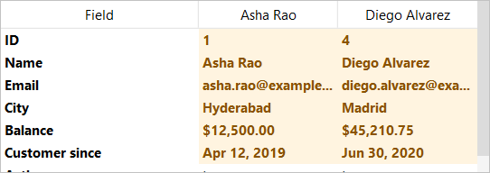

| Module | Classes |
|---|---|
| `rapidswing-table` | `CompareDialog`, `DataGrid.addCompareAction`, `RowAction.Selection.TWO_OR_MORE` |

### Dashboard with charts


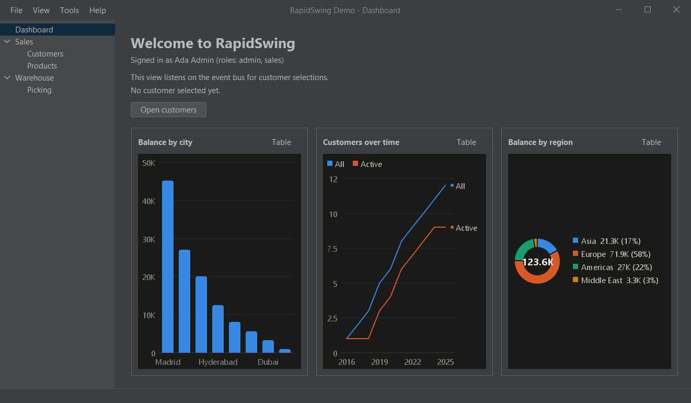

Each chart has tooltips, a legend for two or more series, and a **Table** toggle that shows the numbers. The colors
are checked for color-blind readers and change with the theme.

| Module | Classes |
|---|---|
| `rapidswing-core` | `BarChart`, `LineChart`, `PieChart`, `AbstractChart`, `ChartTheme`; `Themes` for light and dark |
| `rapidswing-demo` | `DashboardView` |

### Screen generated from a JavaBean

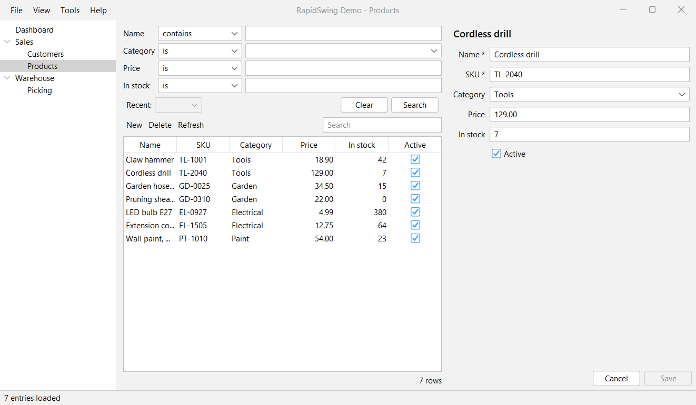

No columns or form written by hand: columns, form fields, the search panel, new items and copies all come from the
`Product` class's properties.

| Module | Classes |
|---|---|
| `rapidswing-crud` | `BeanScreens`, `InMemoryRepository` |
| `rapidswing-core` | `BeanProperties` |
| `rapidswing-demo` | `ProductsScreen`, `model.Product` |

### Forms: errors and warnings

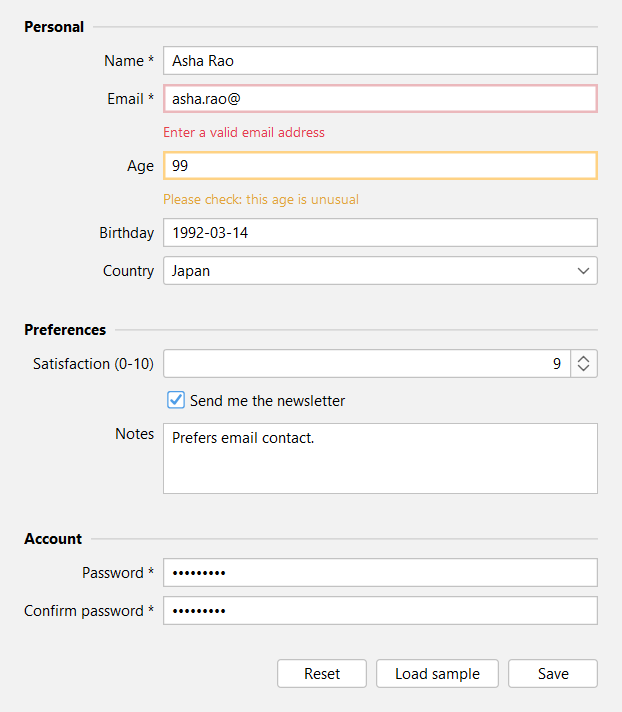

Errors (red) block saving; warnings (amber) only point something out.

| Module | Classes |
|---|---|
| `rapidswing-forms` | `Form`, `FormBuilder`, `FieldBuilder.validate`, `FieldBuilder.warn`, `Validators` |
| `rapidswing-binding` | `Bindings`, `Converters`, `Property` |
| `rapidswing-demo` | `ProfileView`, `model.ProfileModel` |

### Wizard

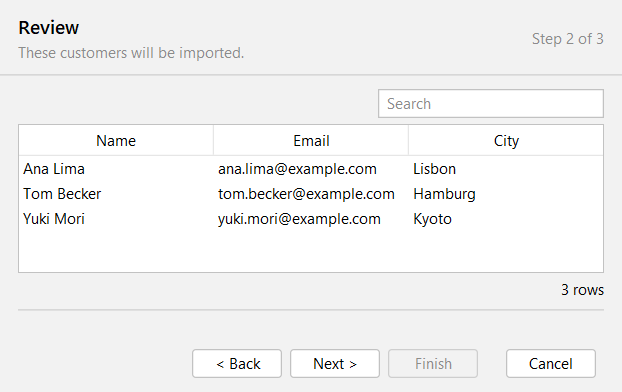

The import wizard parses pasted lines in the background, can send the user back to the first page on an error,
and saves with progress.

| Module | Classes |
|---|---|
| `rapidswing-forms` | `Wizard`, `Wizard.Builder`, `Outcome` |
| `rapidswing-core` | `Progress`, `ProgressModel`, `TaskService.callWithProgress` |
| `rapidswing-demo` | `ImportCustomersWizard` |

### Keyboard-only screen with function keys

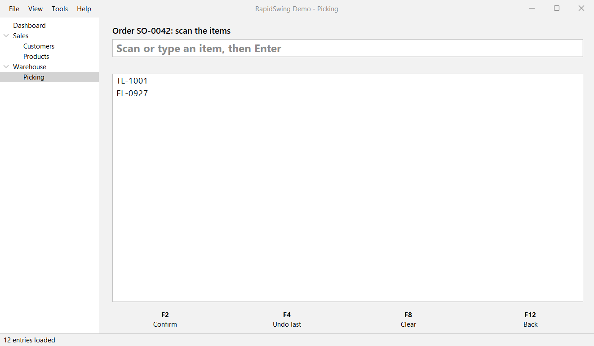

| Module | Classes |
|---|---|
| `rapidswing-core` | `FunctionKeyBar`, `AbstractView` |
| `rapidswing-demo` | `PickingView` |

### Settings

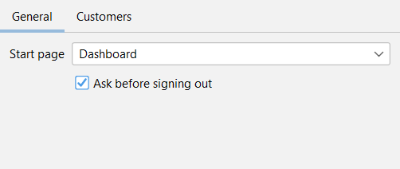

| Module | Classes |
|---|---|
| `rapidswing-forms` | `Settings`, `SettingsDialog` |
| `rapidswing-demo` | `DemoSettings` |

### Sign-in

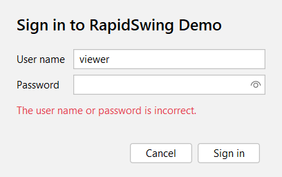

| Module | Classes |
|---|---|
| `rapidswing-core` | `LoginDialog`, `LoginPanel`, `Authenticator`, `SimpleAuthenticator`, `PasswordHasher`, `Session`; `ChangePasswordDialog`, `PasswordChanger` |
| `rapidswing-demo` | `Roles` |

### Languages

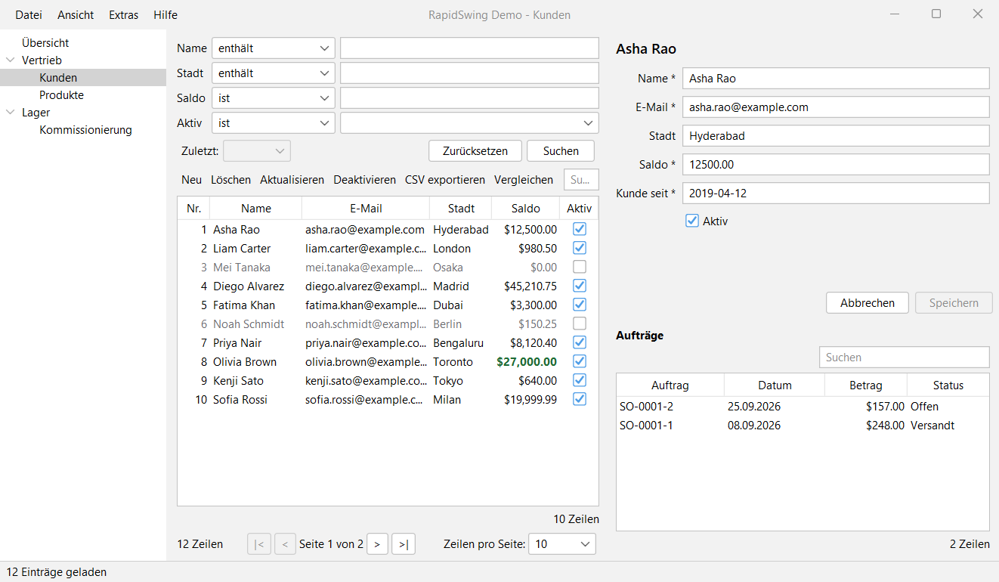

The whole interface follows the chosen language (English, German or Spanish), including menus, the tree, search
operators, dates, numbers and messages.

| Module | Classes |
|---|---|
| `rapidswing-core` | `I18n`, `Utf8Control`, `SwingApp.switchLocale`, `Formats`; framework texts in `com/rapidswing/i18n/rapidswing*.properties` |
| `rapidswing-demo` | `messages*.properties` |

### Log viewer

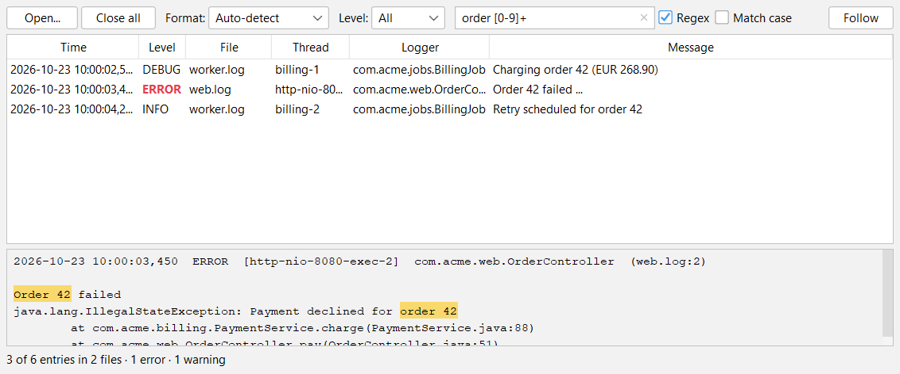

Two log files merged in time order, searched with a regular expression; matches are highlighted in the details.

| Module | Classes |
|---|---|
| `rapidswing-logviewer` | `LogViewer`, `LogFile`, `LogFormat`, `LogEntry`, `LogLevel` |

### Screens for a Spring Boot REST API

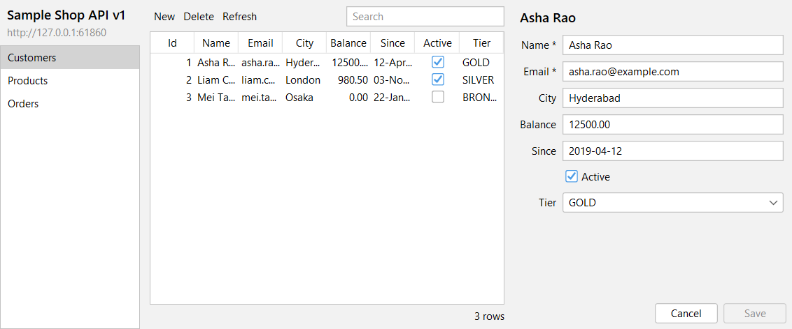

Screens built at run time from the API's OpenAPI document; `RestCodeGenerator` writes the same screens as source.

| Module | Classes |
|---|---|
| `rapidswing-rest` | `ApiExplorer`, `ApiScreens`, `OpenApiSpec`, `RestClient`, `RestRepository`, `ApiRecord`; `codegen.RestCodeGenerator` |

### Application generator

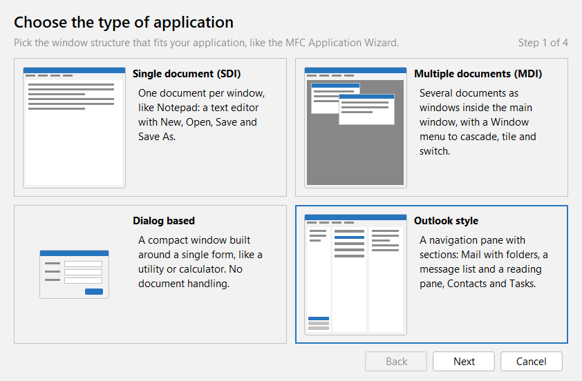

| Single document (SDI) | Multiple documents (MDI, dark theme) |
|---|---|
| 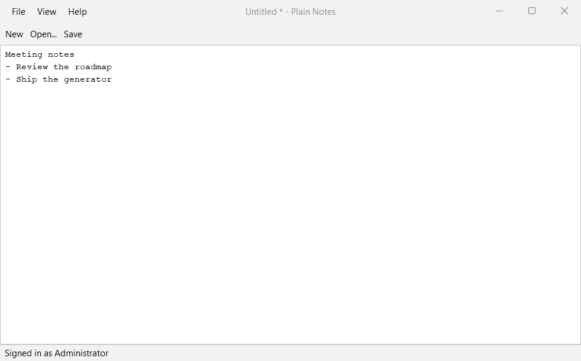 | 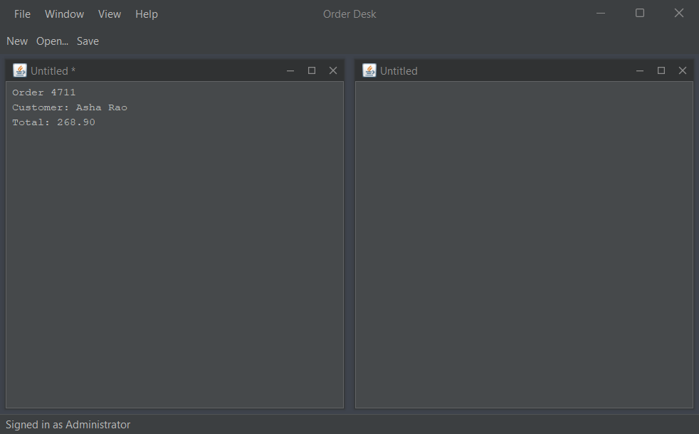 |
| **Dialog based** | **Outlook style** |
| 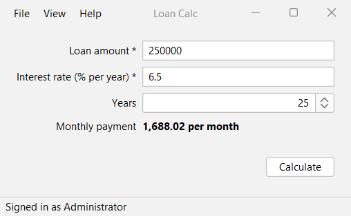 | 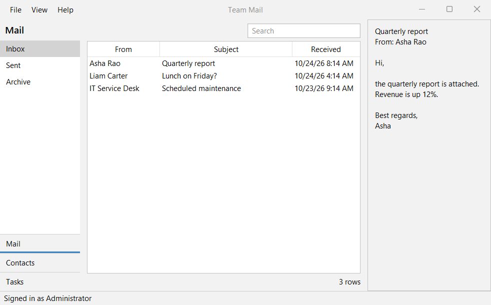 |

| Module | Classes |
|---|---|
| `rapidswing-generator` | `GeneratorWizard`, `WizardPanel`, `TypePreview`, `GeneratorCli`, `ProjectGenerator`, `ProjectSpec`, `Template`, `AppType` |
| `rapidswing-core` (used by the generated apps) | `SwingApp`, `MainFrame`, `MdiWorkspace`, `OutlookPane` |

## Build and run

Scripts for Windows (`.cmd`) and Linux or macOS (`.sh`) build everything and start the applications:

| Windows | Linux / macOS | What it does |
|---|---|---|
| `build` | `./build.sh` | Compile, run all tests, package the runnable jars |
| `build --skip-tests` | `./build.sh --skip-tests` | Compile and package only |
| `build --offline` | `./build.sh --offline` | Use only the local Maven repository |
| `build -- <args>` | `./build.sh -- <args>` | Pass further arguments to Maven |
| `run demo` | `./run.sh demo` | Start the demo app (building it first if needed) |
| `run demo --app.theme=dark --app.locale=de` | `./run.sh demo --app.theme=dark --app.locale=de` | Start the demo with options |
| `run generator` | `./run.sh generator` | Open the application generator wizard |
| `run generator --help` | `./run.sh generator --help` | Use the generator from the command line |

The scripts need Java 8 or newer (`JAVA_HOME`, or `java` on the `PATH`) and Maven 3.6 or newer (`MAVEN_CMD`, `mvn` on
the `PATH`, or a Maven wrapper download in `~/.m2/wrapper`). JVM options for the applications go in `JAVA_OPTS`,
e.g. `JAVA_OPTS=-Xmx512m`.

Without the scripts:

```bash
mvn clean install
java -jar rapidswing-demo/target/rapidswing-demo-0.1.0-SNAPSHOT-app.jar --app.theme=dark
java -jar rapidswing-generator/target/rapidswing-generator-0.1.0-SNAPSHOT-app.jar
```

## Build pipeline and website

Two GitHub Actions workflows run once the project is on GitHub:

- [`.github/workflows/build.yml`](.github/workflows/build.yml) builds and tests on Linux and Windows with Java 8
  and 17 for every push and pull request. It keeps the demo and generator jars as build artifacts. Pushing a tag
  such as `v0.1.0` publishes them as a GitHub release.
- [`.github/workflows/pages.yml`](.github/workflows/pages.yml) publishes a demonstration website to GitHub Pages:
  a page with screenshots and downloads ([`site/index.html`](site/index.html)), and the demo app running in the
  browser ([`site/try.html`](site/try.html)). Turn it on once under *Settings > Pages > Source: GitHub Actions*.

The browser version uses [CheerpJ](https://cheerpj.com), which runs the unchanged demo jar on WebAssembly. Its
free community edition is for personal and non-business use; other use needs a CheerpJ license. Treat it as
experimental: a Swing app in the browser starts slower and may behave differently than with Java.

To preview the website locally:

```bash
./build.sh --skip-tests
bash site/assemble.sh
npx http-server target/site -p 8080
```

Then open http://localhost:8080.

## A minimal app

```java
public class MyApp extends SwingApp {

    public static void main(String[] args) {
        new MyApp().launch(args);
    }

    @Override
    protected void onStartup(AppContext ctx) {
        ctx.services().registerLazy(CustomerService.class, JdbcCustomerService::new);
    }

    @Override
    protected void buildUi(AppContext ctx) {
        ctx.views().register("customers", () -> new CustomersView(ctx));
        ctx.mainFrame().addMenu("File", AppAction.of("Exit", this::exit).shortcut("ctrl Q"));
    }

    @Override
    protected void onReady(AppContext ctx) {
        ctx.views().show("customers");
    }
}
```

Background work, with results delivered on the EDT:

```java
ctx.tasks().call(() -> ctx.service(CustomerService.class).findAll())
        .onSuccess(table::setRows)
        .onError(e -> ctx.dialogs().error("Could not load customers", e))
        .start();
```

Data binding, with a Save action that is enabled only while all input is valid:

```java
BindingGroup form = new BindingGroup();
form.text(nameField, person.name());
form.text(ageField, person.age(), Converters.integer());       // invalid input gets a red outline
form.text(birthdayField, person.birthday(), Converters.localDate());
form.selected(newsletterBox, person.newsletter());
saveAction.enabledWhen(form.valid());

// Plain POJOs work too:
BeanProperty<Customer, String> name = BeanProperty.of(customer, Customer::getName, Customer::setName);
```

A complete validated form in one chain:

```java
Form form = Form.builder()
        .section("Personal")
        .text("Name", person.name()).required().validate(Validators.maxLength(50))
        .text("Email", person.email()).required().validate(Validators.email())
        .integer("Age", person.age()).validate(Validators.range(18, 120))
        .date("Birthday", person.birthday()).validate(Validators.past())
        .section("Account")
        .password("Password", account.password()).required().validate(Validators.minLength(8))
        .password("Confirm password", account.confirm()).required()
            .check(() -> Objects.equals(account.password().get(), account.confirm().get())
                    ? null : "Passwords do not match", account.password())
        .buttons(AppAction.of("Save", this::save))
        .build();

private void save() {
    if (form.validate()) {   // shows every error and focuses the first invalid field
        service.save(person);
    }
}
```

Errors appear under a field once it has been edited or left, or when `validate()` is called, so a new form
doesn't open already full of errors. Input that can't be converted, such as letters in a number field, is
flagged immediately.

A searchable, sortable data grid without writing a table model by hand:

```java
BeanTableModel<Customer> model = BeanTableModel.builder(Customer.class)
        .column("ID", Integer.class, Customer::getId).width(50)
        .column("Name", String.class, Customer::getName)
        .column("Balance", BigDecimal.class, Customer::getBalance).format(money::format)
        .column("Active", Boolean.class, Customer::isActive).hidden()
        .build();

DataGrid<Customer> grid = new DataGrid<>(model)
        .addAction(refreshAction)
        .onOpen(this::edit);                       // double-click or Enter
grid.selectedItem().onChange(this::showDetails);
grid.setRows(customers);                           // keeps the selection on rows still present
grid.exportCsv(Paths.get("customers.csv"));       // visible rows and columns, as displayed
```

Right-click the grid's header to show or hide columns.

A complete list-and-edit screen for an entity, from one definition:

```java
CrudScreen<Customer> screen = CrudScreen.builder(Customer.class)
        .context(ctx)
        .names("Customer", "Customers")
        .repository(customerRepository)            // findAll / save / delete, run in the background
        .newItem(Customer::new)
        .copy(Customer::new)                       // edits a copy, so Cancel really discards
        .itemName(Customer::getName)
        .columns(table -> table
                .column("Name", String.class, Customer::getName)
                .column("Email", String.class, Customer::getEmail))
        .form((form, edit) -> form
                .text("Name", edit.property(Customer::getName, Customer::setName)).required()
                .text("Email", edit.property(Customer::getEmail, Customer::setEmail)).validate(Validators.email()))
        .build();
ctx.views().register("customers", () -> screen);
```

You get New, Delete (with confirmation), Refresh, Save and Cancel, plus Ctrl+N, Ctrl+S and F5. The screen also
asks before discarding unsaved changes when you select another row, refresh, or leave it.

## Internationalization

Put translations in UTF-8 resource bundles (`messages.properties`, `messages_de.properties`, ...) and name the bundle
with `app.bundle=messages`. The framework's own texts (validation messages, grid and CRUD labels, dialog titles) ship
in English, German and Spanish. To change any of them, override its key in your own bundle.

```java
I18n i18n = ctx.i18n();
String title = i18n.get("customers.title");
String status = i18n.get("status.selected", customer.getName());   // MessageFormat patterns
i18n.bind(frame::setBaseTitle, "app.title");                        // follows language changes
i18n.bindAction(saveAction, "action.save");

switchLocale(Locale.GERMAN);   // in your SwingApp: updates texts, rebuilds views, remembers the choice
```

Views are rebuilt on a language switch (`ViewManager.reload()`), so they can simply use `i18n.get(...)` in their
constructors. Use `bind` for long-lived components such as menus, and for the window title.

## Sign-in and roles

Return an `Authenticator` from your `SwingApp`, and the user signs in before the main window appears:

```java
@Override
protected Authenticator authenticator(AppContext ctx) {
    return (username, password) -> userService.login(username, password);   // runs in the background
}

@Override
protected void onLogin(AppContext ctx, User user) {
    ctx.views().show("dashboard");
}

// in buildUi:
Session session = ctx.session();
AppAction delete = AppAction.of("Delete", this::delete).requiresRole(session, "admin");  // hidden in menus otherwise
ctx.views().restrict("admin", session.anyRole("admin"));
AppAction signOut = AppAction.of("Sign out", this::logout);
```

`CrudScreen` takes `allowCreate/allowEdit/allowDelete(session.hasAnyRole(...))`. Items you may not edit are shown
read-only.

- **Sign-in screen:** the password is cleared from memory after every attempt, errors never say whether the user
  name or the password was wrong, and repeated failures add a growing delay. The last user name is remembered;
  the password never is.
- **`SimpleAuthenticator`** checks PBKDF2-SHA256 hashes in constant time and also suits prototypes and tests.
  Generate a hash with `java -cp rapidswing-core.jar com.rapidswing.security.PasswordHasher`.
- **Role checks in the client are a convenience, not a security boundary.** Enforce access where the data is
  (server or database), or at least in your services with `session.require("admin")`.

Demo accounts: `admin`/`admin123` (everything), `sales`/`sales123` (create and edit customers, profile form),
`viewer`/`viewer123` (read-only customers).

## Testing

Add `rapidswing-testing` with test scope and drive real screens the way a user would, with no sleeps:

```java
class CustomersScreenTest {

    @RegisterExtension
    final AppHarnessExtension harness = new AppHarnessExtension(new AppConfig().set("app.bundle", "messages"),
            app -> app.service(CustomerService.class, new FakeCustomerService()));

    @Test
    void salesCanEditButNotDelete() {
        AppHarness app = harness.get().signIn(User.of("sam", "Sam", "sales"));
        CrudScreen<Customer> screen = app.show("customers", CustomersScreen::create);
        Find find = Find.in(screen);

        Ui.onEdt(() -> screen.getGrid().select(screen.getGrid().getModel().getRow(0)));
        Ui.type(find.field("City"), "Pune");          // finds the field by its label
        Ui.click(find.button("Save"));                 // fails if the button is hidden or disabled

        assertEquals("Asha Rao saved", app.status());
        assertThrows(AssertionError.class, () -> find.button("Delete"));
    }
}
```

| Helper | What it does |
|---|---|
| `Ui` | Runs code on the EDT and waits for what it queued; `click`, `type`, `select`, `check` like a user; `waitUntil` |
| `Find` | Finds visible components by button text or field label; failures list what is on screen |
| `TestTasks.immediate()` | Background tasks that run synchronously, so results are there when `Ui` returns |
| `ScriptedDialogs` | Records messages and answers confirmations from a script; unexpected questions fail the test |
| `MemoryPreferences` | Keeps settings in memory, so tests never touch the real user settings |
| `AppHarness` / `AppHarnessExtension` | A full `AppContext` with all of the above, a hidden main window, sign-in and language |

Screen tests need a display, even though no window is shown. Without one (CI without Xvfb), they are skipped
rather than failed. To let Java detect the display, don't force `java.awt.headless=true` for those tests.

## Encryption

AES-256-GCM in `com.rapidswing.crypto`: it encrypts and detects any modification, with a random IV per message and
PBKDF2-SHA256 for passwords.

```java
Encryptor encryptor = Encryptor.withKey(Keys.fromBase64(System.getenv("APP_ENCRYPTION_KEY")));
String sealed = encryptor.encryptToString("IBAN DE89 3704 0044 0532 0130 00");
String plain = encryptor.decryptToString(sealed);

Encryptor.withPassword(password).encryptFile(report, encryptedReport);   // streams any size in 64 KB chunks
```

- **Detects tampering.** A wrong key, a wrong password, modified data, a truncated file and reordered chunks all
  fail with the same `CryptoException`. Decrypting a file never leaves partial plaintext behind.
- **Encrypted settings.** Store secrets in `app.properties` as `db.password=ENC(...)`. They are decrypted with the
  key in the `APP_ENCRYPTION_KEY` environment variable.
- **Command-line tool.** `CryptoTool genkey`, `encrypt`, `encrypt-file` and `decrypt-file`; secrets are read
  without echo.

## Log viewer

`new LogViewer(tasks).open(paths...)` is a view, so you can register it or embed it.

- **Several files at once.** Opened files, or files dropped on the viewer, are merged in time order.
- **Formats.** The format is detected per file: Spring Boot, Logback/Log4j, SLF4J Simple or plain text. You can
  also give your own regular expression with named groups (`timestamp`, `level`, `thread`, `logger`, `message`).
- **Stack traces** stay with their entry.
- **Filtering and search.** Filter by level, and search with plain text or regular expressions; matches are
  highlighted in the detail pane.
- **Follow mode** shows new lines as they are written and copes with rotated files.

## Window layouts: MDI and Outlook

- **`MdiWorkspace`** holds several documents as windows inside the main window, with a ready-made Window menu
  (Cascade, Tile, Close all and the list of open windows). A document with unsaved changes can refuse to close.
- **`OutlookPane`** has a navigation pane with section buttons and folders, plus `withReadingPane(list, preview)`.

## Spring Boot REST APIs

Point RapidSwing at the OpenAPI document that springdoc-openapi serves at `/v3/api-docs`:

```java
RestClient client = new RestClient("https://shop.example.com").withBearerToken(token);
OpenApiSpec spec = OpenApiSpec.fetch(client);                        // in a background task
ctx.views().register("api", () -> new ApiExplorer(ctx, spec, client)); // every resource, no code
```

- **Finding resources.** Paths like `/api/customers` plus `/api/customers/{id}` become CRUD screens. Spring Data
  pages work too.
- **Forms from the schema.** Field types (text, numbers, decimals, dates, booleans, enums) and constraints
  (required, lengths, ranges, `format: email`, patterns) become form fields and validation rules.
- **Only what the API allows.** New, Save and Delete are offered only for operations the API has.
- **Errors.** Error responses show Spring's message, e.g. "email: must be a well-formed email address".
- **Your own code instead.** `RestCodeGenerator` writes a typed class, a repository and a screen per resource.

For trying things out, `SampleApiServer` is a small in-process stand-in for a Spring Boot app with springdoc.

## Application generator

Like Visual Studio's MFC Application Wizard. It creates a complete Maven project that builds as generated and
includes a smoke test.

```bash
java -jar rapidswing-generator/target/rapidswing-generator-0.1.0-SNAPSHOT-app.jar          # opens the wizard
java -jar rapidswing-generator/target/rapidswing-generator-0.1.0-SNAPSHOT-app.jar \
     --type mdi --name "Order Desk" --features login,i18n,logviewer,encryption,dark \
     --openapi http://localhost:8080
```

| Type | What you get |
|---|---|
| `sdi` | One document per window: a text editor with New, Open, Save and Save As, and unsaved-changes protection |
| `mdi` | Several documents as windows inside the main window, with a Window menu |
| `dialog` | A compact window built around one form (the sample is a loan calculator) |
| `outlook` | Navigation pane with Mail (folders, message list, reading pane), Contacts (full CRUD) and Tasks |

- **Features:** sign-in with roles, translations (English, German, Spanish), log viewer, file encryption, dark
  theme.
- **Sign-in password.** With sign-in, the generator creates a random `admin` password and shows it once. The
  project stores only its hash.
- **REST screens.** `--openapi` (a running API's URL or a JSON file) adds generated screens and an API menu.
- **Requirement.** Generated projects depend on RapidSwing, so run `mvn install` in this folder first.

## Navigation, help and application services

An overview of these features, and where the demo uses each one, is in [docs/features.md](docs/features.md).

```java
// A navigation tree beside the views; restricted views and empty folders are hidden.
NavigationTree nav = new NavigationTree(views);
nav.root().folder("sales", "nav.sales").page("/pages/sales.html")   // HTML landing page, links like view:customers
        .view("customers", "nav.customers").view("orders", "nav.orders");
frame.setNavigator(nav);
frame.enableQuickOpen();                                            // Ctrl+K: jump to any view or menu command

HelpService help = new HelpService(views).register("customers", "/help/customers.html"); // customers_de.html for German
frame.addMenu("help", StandardActions.help(help, ctx), StandardActions.shortcuts(ctx), StandardActions.systemInfo(ctx));
frame.addMenu("file", StandardActions.changePassword(this));        // shown when the authenticator is a PasswordChanger
frame.addMenu("window", StandardActions.newWindow(ctx));            // the current view in a window of its own
```

- `Formats.register(Money.class, ...)` sets how a type is shown everywhere. Enums are translated with
  `enum.<Type>.<CONSTANT>` keys, and dates follow the language.
- `ErrorMessages.register(OptimisticLockException.class, e -> "...")` turns exceptions into messages users
  understand. Error dialogs use it.
- `SwingApp` hooks: `onLogout(ctx, user)` and `onRuntimeError(ctx, error)` (return true if you handled it).
- `ProgressDialog.run(frame, "Importing", tasks, progress -> ...)` runs work with a progress bar and Cancel. The work
  calls `progress.begin/step/checkCancelled`.

## Searching, paging and working with rows

```java
CrudScreen.builder(Customer.class)
        .search(panel -> panel.field("name", "Name", String.class)       // operators: contains, between, is empty...
                              .field("balance", "Balance", BigDecimal.class))
        .pageSize(50)                                                     // paging bar under the list
        .details("Orders", Order.class, t -> t.column(...), orders::findFor) // detail table under the form
        .refreshOn(ctx.events(), CustomersChanged.class)                  // or refreshEvery(60)
        ...
```

- Implement `QueryRepository.find(Query)` to search, sort and page on the server. A plain `CrudRepository` is
  searched in memory instead, and `InMemoryRepository` is ready to use for prototypes.
- Rows (`grid` is a `DataGrid<Customer>`):
  - `grid.rowAction("Deactivate", rows -> ...).when(Customer::isActive).confirm("...")` adds an action to the
    toolbar and the right-click menu. It is enabled only for a fitting selection.
  - `grid.addCompareAction()` shows the selected rows side by side.
  - `grid.print("Customers")` prints the list.
- Styles: `.style(v -> v.signum() < 0 ? CellStyle.ERROR : null)` on a column, and `grid.rowStyle(...)` for whole
  rows. The colors suit light and dark themes.
- `BeanScreens.of(Product.class).searchable("name").toBuilder()` builds a complete CRUD screen from a JavaBean at run
  time.

## Forms: warnings, wizards, function keys and settings

- `.warn(rule)` on a field shows an amber message without blocking the save.
- `Wizard.builder(title, tasks).page(...).validate(...).onNext(progress -> Outcome.next() / jump("id") / error("..."))`
  builds a multi-page dialog. Steps run in the background with progress, and Back returns to the previous page.
- `new FunctionKeyBar().key("F2", saveAction)` adds keyboard-only operation for terminal-style screens.
- `Settings` declares typed user settings (`integer`, `bool`, `choice`, `text`) that are saved at once.
  `SettingsDialog.show(frame, settings)` edits them, with import, export and restoring defaults.

## Charts

`BarChart`, `LineChart` and `PieChart` (a donut that folds small segments into "Other") have no extra dependencies.
They use a fixed, color-blind-checked series order with light and dark variants. Every chart has hover tooltips, a
legend for two or more series and `toTable()` for the numbers.

```java
BarChart chart = new BarChart();
chart.categories(Arrays.asList("Jan", "Feb", "Mar")).series("Revenue", 12_000, 15_500, 14_200);
```

## Configuration

`app.properties` on the classpath, overridable with `--key=value` arguments:
`app.id`, `app.title`, `app.theme` (`light`, `dark`, `intellij`, `darcula`, `system`), `app.width`, `app.height`,
`app.bundle` (resource bundle base name) and `app.locale` (starting language tag, e.g. `de`; a language the user
picked takes precedence).

## Java 8 compatibility

Library versions are pinned to lines that still support Java 8 (FlatLaf 3.5, SLF4J 1.7, JUnit 5.8).
When compiling with a newer JDK, add `<maven.compiler.release>8</maven.compiler.release>` so that APIs
newer than Java 8 are rejected at compile time.

## Roadmap

